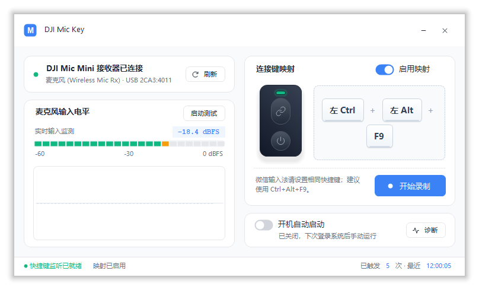
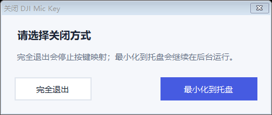

# DJI Mic Key

当前公开版本：**v1.0.0**。可从 [GitHub Releases](https://github.com/111jc/DJIMicKey/releases/latest) 下载。

轻量 Windows 工具：将 DJI Mic Mini 发射器的连接键映射成键盘快捷键，并显示接收器状态和麦克风输入电平。适合用麦克风按键切换语音输入。

这是非 DJI 官方的独立工具。目前实测接收器 USB 标识为 **VID_2CA3 / PID_4011**。

## 功能

- 检测接收器的 HID 和音频接口。
- 显示实时麦克风电平，最小化后暂停音量检测。
- 点击录制目标单键或组合键，保留左右 Ctrl / Alt / Shift / Win 的区别。
- 保存快捷键和映射开关。
- 自适应布局与逐显示器 DPI 调整；缩放兼容默认开启，无需额外开关。
- 可选开机自动启动；点击主窗口 × 可选择完全退出或最小化到托盘。
- 诊断弹窗实时打印媒体键、Windows 多媒体命令和 DJI HID 报告；可导出报告并重启监听。
- 单文件运行，不依赖 AutoHotkey、浏览器或额外下载的运行时。



主界面参考 [HTML 设计稿](docs/design/main-layout.html)，以原生 Windows Forms 实现双栏卡片、渐变键帽、实时电平趋势与独立诊断弹窗。字体遵循参考稿的 Segoe UI 与中文回退规则；底栏分色显示监听状态、映射状态、触发次数和最近触发时间。

## 快速开始

运行环境：Windows 10/11 x64、.NET Framework 4.8。

1. 在项目根目录运行 `Build.cmd`，生成 `dist/DJIMicKey.exe`。
2. 双击生成的程序，或运行 `Start.cmd`。
3. 连接 USB 接收器，确认设备状态并对着麦克风说话测试电平。
4. 点击“开始录制”，按下并松开目标组合键，再点击“应用并保存”。
5. 把输入法的语音快捷键设成相同组合。在文字输入框中，按麦克风连接键开始，再按一次结束。

默认组合是 **左 Ctrl + 左 Alt + F9**。本机验证微信输入法可使用这一组合，单独模拟右 Ctrl 未能触发。

点击主窗口 × 会显示关闭方式选择；选择“最小化到托盘”后映射继续生效，双击托盘图标可恢复窗口。关闭选择框或按 Esc 会取消。`Stop.cmd` 可直接退出正在运行的工具。完整操作见 [Windows 使用说明](docs/WINDOWS.md)。



## 电源键兼容性

两次隔离诊断中，电源键短按未产生可映射事件；配对键产生了 Volume Up/HID 报告。之后的实时诊断又收到多组相同格式的 Volume Up/HID 事件，但数量多于用户报告的两次电源键短按，无法确认其物理来源。当前没有证据证明电源键有独立、可映射的信号。详见 [测试记录](docs/POWER_BUTTON_FINDINGS.md)。
## 映射范围

接收器连接且映射启用时，工具拦截 Windows 的 **Volume Up** 媒体键。因此键盘或其他设备的“音量加”也会触发目标快捷键。当前没有按设备来源隔离，也不安装过滤驱动。

“接收器已连接”不等于发射器无线链路一定正常，请用电平条验证。蓝牙直连和其他 DJI 型号没有保证。

## 构建、测试与打包

```bat
Build.cmd
Test.cmd
Test.cmd --device
Release.cmd
```

- `Build.cmd`：使用系统 C# 编译器构建并运行 57 项基础检查。
- `Test.cmd`：额外验证缩放布局、关闭/托盘行为、原生按键录制和诊断日志实时输出，需要交互式 Windows 桌面。
- `Test.cmd --device`：再检查实际连接的接收器和音频输入。
- `Release.cmd`：构建便携压缩包。重建正式 EXE 前先退出工具。

测试报告生成到 `.build/reports/`；可执行文件和压缩包生成到 `dist/`。这两个目录不纳入 Git。

Win11 上若设备和电平正常、配对键却仍增加音量，按 [Win11 排查步骤](docs/WIN11_TROUBLESHOOTING.md) 导出诊断报告。当前尚未在 Win11 实机复现并确认修复。

## 项目结构

```text
src/                         应用源码
  App.cs                     Windows Forms 界面与应用生命周期
  Core.cs                    设备检测、按键映射、设置和音频监测
  InputDiagnostics.cs        媒体键与 HID 诊断
  PowerWatch.cs              电源键诊断窗口
  AssemblyInfo.cs            程序集版本信息
  app.ico / app.manifest     程序图标和 Windows 清单
tests/                       自检与交互式验证代码
  SelfTests.cs
docs/                        使用、测试和兼容性说明
  WINDOWS.md                 Windows 使用说明
  VALIDATION.md              验证范围与限制
  WIN11_TROUBLESHOOTING.md   Win11 排查步骤
  POWER_BUTTON_FINDINGS.md   电源键测试记录
  design/                    界面参考稿
  images/                    文档截图
Build.cmd / Test.cmd / Release.cmd  构建、验证和打包
Start.cmd / Stop.cmd               启动与退出
```

源码仅使用 .NET Framework 和 Windows API，无 NuGet 依赖。构建产物与本地验证报告分别生成到被 Git 忽略的 `dist/` 和 `.build/`，不需要纳入源码仓库。贡献方式见 [CONTRIBUTING.md](CONTRIBUTING.md)，版本记录见 [CHANGELOG.md](CHANGELOG.md)。

## License

[MIT](LICENSE)。DJI 和微信输入法等名称仅用于说明兼容对象，不表示官方隶属或授权关系。
